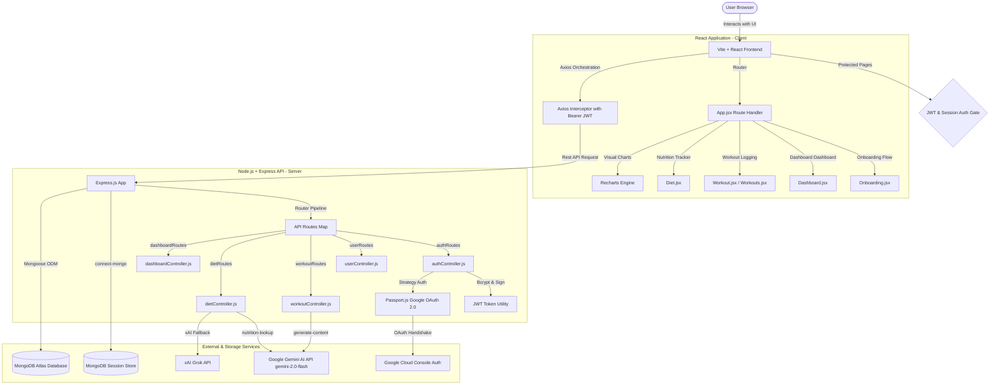

# 🏋️‍♂️ FitTrack - AI-Powered Fitness & Nutrition Ecosystem

FitTrack is a premium, full-stack health, nutrition, and workout tracking ecosystem. It integrates traditional health metrics tracking (workout logging, calorie logging, weight history, and BMI calculations) with Generative AI capabilities (Google Gemini API & xAI Grok API) to provide users with dynamically tailored workout and diet roadmaps, natural language food lookups, and intelligent context-aware progress summaries.

---

## 🧭 Table of Contents
1. [🏗️ Architecture & System Design](#️-architecture-system-design)
2. [🤖 Core AI Engines](#-core-ai-engines)
3. [🔐 Authentication & Security Flow](#-authentication--security-flow)
4. [📊 Database Schema & Data Models](#-database-schema--data-models)
5. [🔌 API Reference & Routing Map](#-api-reference--routing-map)
6. [🛠️ Tech Stack Directory](#️-tech-stack-directory)
7. [📂 Project Structure & Directory Map](#-project-structure--directory-map)
8. [🚀 Getting Started & Local Installation](#-getting-started--local-installation)
9. [🖥️ Production & Deployment](#️-production--deployment)

---

## 🏗️ Architecture & System Design

FitTrack is structured as a decoupled client-server MERN stack application. Below is the workflow diagram showcasing how the frontend React client, Node/Express backend, database, authentication providers, and Generative AI engines interact.



---

## 🤖 Core AI Engines

FitTrack implements Generative AI to automate workout program design and meal tracking. Rather than using conversational chatbots that return unformatted text, FitTrack utilizes **native JSON outputs** from the AI to seed database models directly.

### 🏋️‍♂️ 1. AI Workout Planner (`workoutController.js`)
* **Engine**: Google Gemini API (`gemini-2.0-flash`).
* **Input**: User's physical parameters (age, weight, height), fitness level, and desired goals (e.g., hypertrophy, endurance, fat loss, flexibility).
* **System Prompting**: Configured with strict instructions to output valid JSON.
* **Mechanism**: The backend calls the `gemini-2.0-flash` model and sets the `responseMimeType` parameter to `application/json`.
* **Output Schema**:
  ```json
  {
    "plan": {
      "title": "ELITE PERFORMANCE: Hypertrophy Split",
      "overview": "7-day muscle hypertrophy cycle focused on progressive overload...",
      "days": [
        {
          "day": "Day 1",
          "type": "Upper Body Strength",
          "exercises": [
            { "name": "Bench Press", "sets": 4, "reps": "8-10", "rest": "90s" }
          ]
        }
      ]
    }
  }
  ```

### 🥗 2. AI Nutrition Planner (`dietController.js`)
* **Engine**: Google Gemini API (`gemini-2.0-flash`).
* **Input**: User's target goals (e.g., caloric deficit for fat loss, caloric surplus for muscle gain) and dietary restrictions (e.g., vegetarian, vegan, pescatarian, any).
* **Output Schema**:
  ```json
  {
    "plan": {
      "dailyCalories": 2200,
      "macros": { "protein": "150g", "carbs": "250g", "fats": "70g" },
      "meals": {
        "Breakfast": ["Oatmeal with whey protein", "1 medium banana"],
        "Lunch": ["Grilled paneer/chicken with brown rice", "Mixed greens"],
        "Snacks": ["Almonds (30g)", "1 Apple"],
        "Dinner": ["Sautéed tofu/fish with sweet potato", "Broccoli"]
      }
    }
  }
  ```

### 🔍 3. AI Natural Language Nutrition Lookup (`dietController.js`)
* Instead of forcing users to search rigid, limited databases, FitTrack features a natural language search query box.
* **Processing**: The user enters a sentence (e.g., `"3 scrambled eggs and avocado"`).
* **AI Parser**: The Gemini API processes this input and estimates the nutritional breakdown, returning a clean JSON object containing `calories`, `protein`, `carbs`, and `fats`.
* **Flow**: The parsed numbers are returned to the user, allowing them to adjust parameters and log the meal to MongoDB with one click.

---

## 🔐 Authentication & Security Flow

FitTrack implements a secure, stateless session authentication model coupled with social single sign-on (SSO).

```
[Credentials Login] ──> Hashed in DB (Bcryptjs) ──> Issue JWT ──> Client LocalStorage
                                                                        │
[Google SSO Login]  ──> Passport.js OAuth 2.0 ──> Issue JWT ──> Client LocalStorage
                                                                        │
[Outgoing Requests] ◄───────────────────────────────────────────────────┘
       │
 Axios Request Interceptor
       │ (Appends Authorization: Bearer <token> header)
       ▼
Express Server Validation ──> decode JWT ──> Hydrate req.user ──> Next()
```

1. **Credentials Pipeline**: Standard sign-ups secure password inputs using `bcryptjs` with a salt factor of 10.
2. **Google OAuth 2.0 Integration**: Built using `Passport.js` with the `passport-google-oauth20` strategy. The frontend opens the OAuth screen using `@react-oauth/google` and routes callbacks back to the Express server to initiate standard session verification.
3. **Session Store Persistence**: Uses `express-session` backed by `connect-mongo` to persist OAuth states and sessions directly in MongoDB Atlas with a 14-day Time-To-Live (TTL) expiration.
4. **Stateless JWT Guard**: Upon successful verification, the backend issues a signed JSON Web Token (JWT). The React client stores this token in `localStorage`.
5. **Axios Client Interceptors**:
   * **Request Interceptor**: Automatically inspects `localStorage` for `fittrack_token` and appends it to the `Authorization: Bearer <token>` header of every outbound API request.
   * **Response Interceptor**: Monitors API responses. If the backend throws a `401 Unauthorized` (indicating token expiry or tampering), the interceptor wipes the local credentials storage and redirects the browser back to the `/login` route.

---

## 📊 Database Schema & Data Models

The database architecture consists of 6 Mongoose collections in MongoDB Atlas.

### 👤 1. User Model (`models/User.js`)
Stores user profiles, preferences, and onboarding flags:
* `name` (String, required)
* `email` (String, unique, indexed)
* `password` (String, default null for OAuth users)
* `googleId` (String, unique sparse index for OAuth identification)
* `age`, `weight` (kg), `height` (cm)
* `goal` (Enum: `fat_loss`, `muscle_gain`, `body_recomposition`, `maintain`, `strength`, `endurance`, `general_fitness`, `flexibility`)
* `dietType` (Enum: `vegetarian`, `non-vegetarian`, `vegan`, `pescatarian`, `any`)
* `activityLevel` (Enum: `sedentary`, `light`, `moderate`, `active`, `very_active`)
* `workoutLocation` (Enum: `Home`, `Gym`)
* `isOnboarded` (Boolean, defaults to false)

### 🏋️‍♂️ 2. Workout Plan Model (`models/Workout.js`)
Saves generated AI workout splits:
* `userId` (ObjectId referencing `User`, indexed)
* `plan` (Object representing the generated 7-day nested plan)

### 🥗 3. Diet Plan Model (`models/Diet.js`)
Saves generated AI diet roadmaps:
* `userId` (ObjectId referencing `User`, indexed)
* `plan` (Object representing the daily macro thresholds and food choices)

### 📝 4. Workout Logs (`models/WorkoutLog.js`)
Tracks history of completed exercises:
* `userId` (ObjectId referencing `User`)
* `exercise` (String, required)
* `sets` (Number, required)
* `reps` (Number, required)
* `weight` (Number, defaults to 0 for bodyweight exercises)
* `date` (Date, defaults to current time)

### 🍎 5. Diet Logs (`models/DietLog.js`)
Tracks daily caloric consumption:
* `userId` (ObjectId referencing `User`)
* `name` (String, representing the meal description)
* `calories` (Number, required)
* `protein`, `carbs`, `fats` (Numbers, defaults to 0)
* `date` (Date, defaults to current time)

### 💾 6. Log Model (`models/Log.js`)
* Unified backwards-compatible collection logging general workout, weight, or food events dynamically.

---

## 🔌 API Reference & Routing Map

All backend routes are protected by the `jwtAuth` middleware, which decodes authorization headers and queries Mongoose to populate `req.user`.

### 🔐 Authentication Routes (`/api/auth`)
| Method | Endpoint | Description | Auth Required |
|:---|:---|:---|:---|
| `POST` | `/api/auth/signup` | Registers new user; hashes password via bcryptjs | No |
| `POST` | `/api/auth/login` | Validates credentials; returns JWT token & user object | No |
| `GET` | `/api/auth/google` | Triggers Google Passport.js OAuth flow | No |
| `GET` | `/api/auth/google/callback` | OAuth redirect landing; establishes session and serves token | No |

### 👤 User Profile Routes (`/api/user`)
| Method | Endpoint | Description | Auth Required |
|:---|:---|:---|:---|
| `GET` | `/api/user/profile` | Retrieves current logged-in user profile metrics | Yes |
| `PUT` | `/api/user/update` | Updates physical details and triggers onboarding state | Yes |
| `DELETE` | `/api/user/profile` | Disposes user profile and linked tracking history | Yes |

### 🏋️‍♂️ Workout Routes (`/api/workout`)
| Method | Endpoint | Description | Auth Required |
|:---|:---|:---|:---|
| `POST` | `/api/workout/generate`| Queries Gemini for customized 7-day training splits | Yes |
| `POST` | `/api/workout/log` | Inserts completed exercise, sets, reps, and weights | Yes |
| `GET` | `/api/workout/history` | Fetches historical workout log entries | Yes |
| `GET` | `/api/workout/recent-exercises` | Suggests recently logged exercises for quick selection | Yes |
| `DELETE`| `/api/workout/history/:id`| Disposes a specific saved AI workout plan | Yes |

### 🥗 Diet & Nutrition Routes (`/api/diet`)
| Method | Endpoint | Description | Auth Required |
|:---|:---|:---|:---|
| `POST` | `/api/diet/generate` | Queries Gemini for customized 7-day caloric diet plans | Yes |
| `POST` | `/api/diet/log` | Adds a logged meal (calories + macronutrients) to history | Yes |
| `GET` | `/api/diet/history` | Fetches history of logged calorie intake | Yes |
| `GET` | `/api/diet/recent-foods` | Queries top 10 recently consumed meals for autocomplete | Yes |
| `GET` | `/api/diet/lookup` | Parses query string via Gemini to estimate calories/macros | Yes |

### 📊 Dashboard & Tracker Routes (`/api/tracker` & `/api/dashboard`)
| Method | Endpoint | Description | Auth Required |
|:---|:---|:---|:---|
| `GET` | `/api/tracker` | Fetches general stats and normalized analytics graphs data | Yes |
| `GET` | `/api/dashboard` | Aggregates daily calorie performance, streak, and recent logs | Yes |

---

## 🛠️ Tech Stack Directory

### Frontend (Client Module)
* **React 19 (Vite)**: Component-driven UI framework with fast hot module replacement (HMR).
* **React Router DOM v7**: Declarative routing with path protection to block access for unlogged users.
* **Tailwind CSS & Autoprefixer**: Utility-first CSS styling incorporating glassmorphism layouts and responsive design.
* **Framer Motion**: Hardware-accelerated animations for dashboard entry states and modal transitions.
* **Recharts**: D3-based charting framework used to map daily and weekly calorie progress, weight variations, and user BMI targets.
* **Lucide React**: Modern iconography toolkit.
* **React Hot Toast**: Beautiful, non-blocking notification indicators for feedback alerts.
* **Axios**: HTTP communication engine handling client-server API requests.

### Backend (Server Module)
* **Node.js & Express**: High-concurrency event-loop runtime and routing server.
* **Mongoose**: Schematized Object Data Modeling (ODM) layer mapping data structures to MongoDB Atlas.
* **Google Generative AI SDK (`@google/generative-ai`)**: Native SDK querying `gemini-2.0-flash` with system guidelines and JSON schema modes.
* **OpenAI SDK**: Helper library for xAI Grok API integration.
* **Passport.js & Passport Google OAuth 2.0**: Social SSO login provider.
* **Jsonwebtoken (JWT) & Bcryptjs**: Cryptographic secure signing, parsing, and password hashing utility.
* **Connect Mongo & Express Session**: Key-value session store utilizing MongoDB Atlas to persist server session identifiers.

---

## 📂 Project Structure & Directory Map

```text
wt-project/ (Root Workspace)
├── client/                     # React + Vite Client Application
│   ├── src/
│   │   ├── components/         # Global Shared UI Components
│   │   │   ├── ui/             # Reusable UI Controls (Button, Input, Alert, Card, Select)
│   │   │   ├── modals/         # Input Form Overlays (LogFoodModal, LogWorkoutModal)
│   │   │   ├── Layout.jsx      # Dashboard Frame, Responsive Navbar & Content Container
│   │   │   └── PageBackground.jsx # Uniform page gradient layout overlay
│   │   ├── context/            # Shared Context Providers
│   │   │   └── AuthContext.jsx # Global User State, Session Checking, Login/Logout Handler
│   │   ├── pages/              # View Container Components
│   │   │   ├── Dashboard.jsx   # Analytics Summary, Streaks, Daily Reminders, Target Widgets
│   │   │   ├── Diet.jsx        # Diet View, Food lookup forms, Macro calculations
│   │   │   ├── Landing.jsx     # Marketing landing page containing tech metrics
│   │   │   ├── Login.jsx       # Standard Credentials login layout & OAuth buttons
│   │   │   ├── OAuthCallback.jsx # Capture token params redirected from Google Login
│   │   │   ├── Onboarding.jsx  # Multi-page form tracking physical params & user goals
│   │   │   ├── Profile.jsx     # User details settings panel
│   │   │   ├── Signup.jsx      # New account registration view
│   │   │   ├── Tracker.jsx     # Aggregated view of historical food logs and exercises
│   │   │   ├── Workout.jsx     # Current Active 7-day Workout plan & log controls
│   │   │   └── Workouts.jsx    # General workout plan selector & history cards
│   │   ├── services/
│   │   │   └── api.js          # Axios API Interceptor Instance with configured auth hooks
│   │   ├── utils/              # Client Helper Utilities
│   │   ├── App.jsx             # Main Router configuring Protected Routes and Gates
│   │   ├── index.css           # Styling entrypoint (loads custom scrollbars & tailwind configurations)
│   │   └── main.jsx            # React root DOM initialization
│   └── package.json            # Frontend script tasks & dependencies
├── server/                     # Node.js Express Backend API
│   ├── config/                 # Environmental & Database Integrations
│   │   ├── db.js               # MongoDB Connection logic using Mongoose
│   │   ├── gemini.js           # Google Generative AI configurations and safety parameters
│   │   ├── grok.js             # xAI Grok OpenAI Client configuration
│   │   └── passport.js         # Google OAuth login strategies configuration
│   ├── controllers/            # Controller Action Logic (Binds Route definitions to Database)
│   │   ├── authController.js   # User account validation, creation & verification
│   │   ├── dashboardController.js # Analytics aggregator & streak engine calculations
│   │   ├── dietController.js   # Meal plans generator & lookup controller
│   │   ├── trackerController.js # Aggregated logs queries
│   │   ├── userController.js   # Profile updates & account deletion
│   │   └── workoutController.js # Exercise routines generator & loggers
│   ├── middleware/             # Request Interceptors
│   │   ├── authMiddleware.js   # Restrict endpoints to validated JWT Bearer requests
│   │   └── errorMiddleware.js  # Catch-all handles for 404 routes & uncaught system errors
│   ├── models/                 # Mongoose Database Collection Schemas
│   ├── routes/                 # Express Endpoint routing tables
│   ├── server.js               # System entry point initializing server
│   └── package.json            # Backend dependencies & boot configurations
├── package.json                # Root Workspace orchestrator script configurations
└── wt_project_details.pdf      # Architectural Reference PDF
```

---

## 🚀 Getting Started & Local Installation

### Prerequisites
* **Node.js** version 18 or higher installed locally.
* **MongoDB Atlas** account or local MongoDB Instance running.
* **Google Cloud Console Project** with OAuth credentials enabled (for Google Login).
* **Google Gemini API Key** (from Google AI Studio).
* **xAI API Key** (optional, for Grok AI integration).

### Step 1: Clone the Repository
```bash
git clone https://github.com/pr-04/FitTrack.git
cd FitTrack
```

### Step 2: Configure Environment Variables
Create a `.env` file inside the `server/` directory:
```env
# Server Network Port
PORT=5000
NODE_ENV=development

# MongoDB Access URI
MONGO_URI=mongodb+srv://<username>:<password>@cluster0.mongodb.net/fittrack?retryWrites=true&w=majority

# Cryptographic Signatures
JWT_SECRET=your_jwt_signing_secret_key_here
SESSION_SECRET=your_express_session_secret_here

# Google Generative AI Studio API Credentials
GEMINI_API_KEY=AIzaSy...your_gemini_api_key...
GEMINI_MODEL=gemini-2.0-flash

# xAI Grok Console API Keys (Optional fallback)
XAI_API_KEY=xai-...your_grok_api_key...

# Google OAuth 2.0 Client Credentials (obtained from Google Cloud Console Credentials page)
GOOGLE_CLIENT_ID=your_google_client_id.apps.googleusercontent.com
GOOGLE_CLIENT_SECRET=GOCSPX-your_google_client_secret_here

# Frontend Client Address
CLIENT_URL=http://localhost:5173
```

Create a `.env` file inside the `client/` directory:
```env
# Backend API Base Endpoint
VITE_API_URL=http://localhost:5000/api

# Google Auth Client Key
VITE_GOOGLE_CLIENT_ID=your_google_client_id.apps.googleusercontent.com
```

### Step 3: Install Workspace Dependencies
Execute this command at the **root directory** of the project workspace. This triggers the installation scripts for both modules:
```bash
npm run install-all
```

### Step 4: Start the Development Server
You can boot both the frontend client and the backend server concurrently from the root directory:
```bash
npm run dev
```

* The **React Client** will be accessible at: [http://localhost:5173](http://localhost:5173)
* The **Express API Server** runs at: [http://localhost:5000](http://localhost:5000)

---

## 🖥️ Production & Deployment

When building and compiling for production (e.g. Render, Vercel, Heroku):
1. **Compilation Command**: Runs `npm run build` from the workspace root. This is defined in `package.json` and executes:
   ```bash
   npm run install-all && npm run build --prefix client
   ```
2. **Serving Static Assets**: The compiled static assets of the frontend are written to `client/dist`. The Express backend serves these files statically:
   ```javascript
   const clientPath = path.join(__dirname, '../client/dist');
   app.use(express.static(clientPath));
   ```
3. **Catch-All SPA Routing**: Since the client is a Single Page Application (SPA), routes like `/app/dashboard` or `/app/diet` must be routed back to React Router. The Express server provides a catch-all route at the bottom of its stack to redirect arbitrary browser requests back to the frontend build:
   ```javascript
   app.get('*', (req, res) => {
       res.sendFile(path.join(clientPath, 'index.html'));
   });
   ```

---

## 👤 Author
Developed and maintained by **Priyanshu Ranjan** ([GitHub Profile](https://github.com/pr-04)).
For contributions, bug reports, and features request, please open a pull request or file an issue in the main repository.
