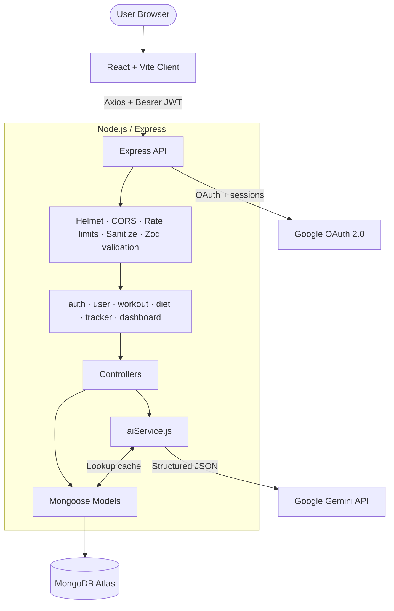

# 🏋️ FitTrack — AI-Powered Fitness & Nutrition Tracker

FitTrack is a full-stack MERN app that combines everyday health tracking (workout logs, calorie logs, weight and BMI) with Google Gemini to generate personalised 7-day workout and diet plans and to turn plain-English meal descriptions into calorie and macro estimates.

[](#-testing)
[](LICENSE)


**🔗 Live demo:** `<your-deployed-url>`

<!-- Add screenshots to docs/screenshots/ and uncomment:


-->

---

## 📑 Table of Contents

1. [Features](#-features)
2. [Tech Stack](#-tech-stack)
3. [Architecture](#-architecture)
4. [AI Engine](#-ai-engine)
5. [Authentication & Security](#-authentication--security)
6. [Data Models](#-data-models)
7. [API Reference](#-api-reference)
8. [Project Structure](#-project-structure)
9. [Getting Started](#-getting-started)
10. [Environment Variables](#-environment-variables)
11. [Testing](#-testing)
12. [Maintenance Scripts](#-maintenance-scripts)
13. [Deployment](#-deployment)
14. [License & Author](#-license--author)

---

## ✨ Features

- **AI workout planner** — a personalised 7-day split based on your age, weight, height, fitness level, goal and workout location (home or gym).
- **AI diet planner** — daily calorie and macro targets with meal suggestions, respecting dietary preferences (vegetarian, vegan, pescatarian, etc.).
- **Natural-language food lookup** — type "3 scrambled eggs and avocado" and get estimated calories, protein, carbs and fats, then log it in one click.
- **Workout & meal logging** — record exercises (sets, reps, weight) and meals, with quick suggestions from your recent entries.
- **Dashboard & tracker** — daily calorie performance, streaks, weight/BMI trends and history charts.
- **Guided onboarding** — a short profile setup that drives all targets and plans.
- **Email/password and Google sign-in**.
- **Production-minded backend** — validation, rate limiting, secure headers, retry/fallback logic for AI calls, and a unit-test suite.

---

## 🛠 Tech Stack

| Layer | Technologies |
|:---|:---|
| **Frontend** | React 19, Vite, React Router v7, Tailwind CSS, Framer Motion, Recharts, Lucide React, React Hot Toast, Axios |
| **Backend** | Node.js, Express, Mongoose, Zod, Passport (Google OAuth 2.0), JSON Web Tokens, bcryptjs |
| **Security** | Helmet, CORS allowlist, express-rate-limit, express-mongo-sanitize, express-session + connect-mongo |
| **AI** | Google Gemini via the `@google/genai` SDK |
| **Database** | MongoDB Atlas |
| **Hosting** | Vercel (client) and Render (server) |

---

## 🏗 Architecture



The client and server are deployed separately. The client talks to the API through a single Axios instance that attaches the JWT and redirects to `/login` on a `401`.

---

## 🤖 AI Engine

All AI calls go through `server/services/aiService.js`. Gemini is asked for **structured JSON**, which is validated with Zod (`server/validators/planSchemas.js`) before anything is saved, so malformed or out-of-range model output never reaches the database.

| Feature | Endpoint | What it does |
|:---|:---|:---|
| Workout plan | `POST /api/workout/generate` | Builds a 7-day plan from the user's profile and goal |
| Diet plan | `POST /api/diet/generate` | Builds daily calories, macros and meals |
| Food lookup | `GET /api/diet/lookup` | Estimates calories and macros from free text |

**Reliability features**

- A shared overall deadline and a per-attempt timeout for every request.
- Schema validation with value clamping, plus one retry if the response fails to parse.
- On `503` errors, one jittered retry, then fallback to an optional second model (`GEMINI_FALLBACK_MODEL`).
- On `429` (quota) errors, an immediate switch to the fallback model.
- A `NutritionCache` collection so repeated food lookups don't spend API quota.

**Example workout plan shape**

```json
{
  "plan": {
    "title": "Hypertrophy Split",
    "overview": "7-day muscle-building cycle focused on progressive overload",
    "days": [
      {
        "day": "Day 1",
        "type": "Upper Body Strength",
        "exercises": [
          { "name": "Bench Press", "sets": 4, "reps": "8-10", "rest": "90s" }
        ]
      }
    ]
  }
}
```

---

## 🔐 Authentication & Security

**Email/password:** passwords are hashed with bcrypt, and a signed JWT is returned on login. The client stores it in `localStorage` (`fittrack_token`) and sends it as `Authorization: Bearer <token>`.

**Google sign-in** uses a short-lived, single-use code instead of putting a token in the URL:

```
Browser ──► /api/auth/google ──► Google consent screen
                                     │
Google ──► /api/auth/google/callback (server verifies the Google profile)
                                     │
Server creates a single-use code (stored hashed) ──► redirects to client /oauth/callback?code=…
                                     │
Client ──► POST /api/auth/oauth/exchange { code } ──► receives JWT
```

An existing account is only linked to a Google login when Google reports the email as verified.

**Hardening in place**

| Protection | Details |
|:---|:---|
| Secure headers | Helmet |
| CORS | Allowlist built from `CLIENT_URL` and `ALLOWED_ORIGINS` |
| Input validation | Zod schemas on every write route and on AI inputs |
| NoSQL injection | `express-mongo-sanitize` |
| Rate limiting | See table below |
| Production checks | The server refuses to start in production if required secrets are missing |
| Error handling | Internal error details are hidden in production responses |

**Rate limits**

| Scope | Limit |
|:---|:---|
| All `/api` routes | 200 requests / 15 min |
| Auth routes | 20 / 15 min (configurable with `AUTH_RATE_LIMIT_MAX`) |
| AI plan generation | 10 / 15 min and 30 / hour per user |
| Food lookup | 60 / 15 min and 300 / hour per user |

---

## 📊 Data Models

| Model | Purpose |
|:---|:---|
| `User` | Profile, goal, diet type, activity level, workout location, onboarding flag, optional `googleId` |
| `Workout` | Saved AI-generated workout plan per user |
| `Diet` | Saved AI-generated diet plan per user |
| `WorkoutLog` | Completed exercises (exercise, sets, reps, weight, date) |
| `DietLog` | Logged meals (name, calories, protein, carbs, fats, date) |
| `Log` | Legacy unified log collection kept for backward compatibility |
| `NutritionCache` | Cached results of AI food lookups |
| `OAuthCode` | Single-use Google sign-in codes (stored hashed, expire automatically) |

---

## 🔌 API Reference

All routes are prefixed with `/api`. Routes marked 🔒 need an `Authorization: Bearer <token>` header.

### Auth — `/api/auth`

| Method | Endpoint | Description |
|:---|:---|:---|
| `POST` | `/signup` | Create an account |
| `POST` | `/login` | Log in and receive a JWT |
| `GET` | `/google` | Start Google OAuth |
| `GET` | `/google/callback` | Google redirect target |
| `POST` | `/oauth/exchange` | Exchange the single-use code for a JWT |

### User — `/api/user` 🔒

| Method | Endpoint | Description |
|:---|:---|:---|
| `GET` | `/profile` | Get the current profile |
| `PUT` | `/profile` | Update profile / complete onboarding |
| `DELETE` | `/profile` | Delete the account and its data |

### Workout — `/api/workout` 🔒

| Method | Endpoint | Description |
|:---|:---|:---|
| `POST` | `/generate` | Generate an AI workout plan |
| `POST` | `/log` | Log a completed exercise |
| `GET` | `/history` | Workout history |
| `GET` | `/recent-exercises` | Recently used exercises |
| `DELETE` | `/history/:id` | Delete a history entry |

### Diet — `/api/diet` 🔒

| Method | Endpoint | Description |
|:---|:---|:---|
| `POST` | `/generate` | Generate an AI diet plan |
| `POST` | `/log` | Log a meal |
| `GET` | `/history` | Meal history |
| `GET` | `/recent-foods` | Recently logged foods |
| `GET` | `/lookup` | Estimate nutrition from free text |

### Tracker & Dashboard 🔒

| Method | Endpoint | Description |
|:---|:---|:---|
| `GET` | `/api/tracker` | Aggregated stats for charts |
| `GET` | `/api/dashboard` | Daily summary, streaks and recent logs |

---

## 📂 Project Structure

```text
FitTrack/
├── client/                      # React + Vite frontend
│   ├── src/
│   │   ├── components/          # Layout, ErrorBoundary, ui/, modals/
│   │   ├── context/             # AuthContext
│   │   ├── pages/               # Landing, Login, Signup, Onboarding, Dashboard,
│   │   │                        # Workout, Diet, Tracker, Profile, OAuthCallback
│   │   ├── services/api.js      # Axios instance + interceptors
│   │   └── utils/               # biometrics, labels, repsClassifier
│   └── vercel.json              # SPA rewrite rules
├── server/                      # Express API
│   ├── config/                  # db, gemini, passport
│   ├── controllers/             # auth, user, workout, diet, tracker, dashboard
│   ├── middleware/              # auth, errors, rateLimiters, validate
│   ├── models/                  # Mongoose schemas
│   ├── routes/                  # Express routers
│   ├── services/aiService.js    # Gemini calls, retries, fallback, caching
│   ├── validators/              # Zod schemas (requests and AI output)
│   ├── utils/                   # biometrics, enums, targets, time, userResponse
│   ├── tests/                   # Unit tests (node:test)
│   └── server.js                # App entry point
├── scripts/                     # One-off DB maintenance and smoke-test scripts
├── PROJECT_CONTEXT.md           # Extended technical notes
├── LICENSE
└── package.json                 # Root scripts (install-all, build, test, start)
```

---

## 🚀 Getting Started

### Prerequisites

- **Node.js 20+** and npm
- A **MongoDB Atlas** cluster (or a local MongoDB instance)
- A **Google Gemini API key** from [Google AI Studio](https://aistudio.google.com/)
- A **Google Cloud OAuth client** (only if you want Google sign-in)

### 1. Clone and install

```bash
git clone <your-repo-url>
cd FitTrack
npm run install-all
```

### 2. Configure environment variables

```bash
cp server/.env.example server/.env
cp client/.env.example client/.env
```

Then fill in the values (see [Environment Variables](#-environment-variables)). **Never commit real `.env` files.**

### 3. Google OAuth setup (optional)

In Google Cloud Console → APIs & Services → Credentials, create an OAuth client and add:

- **Authorized JavaScript origin:** `http://localhost:5173`
- **Authorized redirect URI:** `http://localhost:5000/api/auth/google/callback`

### 4. Run it

Start the two apps in separate terminals:

```bash
npm start --prefix server      # API on http://localhost:5000
npm run dev --prefix client    # App on http://localhost:5173
```

---

## 🔧 Environment Variables

### Server — `server/.env`

| Variable | Required | Description |
|:---|:---:|:---|
| `NODE_ENV` | No | `development` or `production` |
| `PORT` | No | API port (default `5000`) |
| `MONGO_URI` | **Yes** | MongoDB connection string |
| `JWT_SECRET` | **Yes** | Long random string used to sign JWTs |
| `JWT_EXPIRE` | No | Token lifetime (e.g. `30d`) |
| `SESSION_SECRET` | **Yes** | Secret for the OAuth handshake session |
| `GEMINI_API_KEY` | **Yes** | Google Gemini API key |
| `GEMINI_MODEL` | No | Model for plan generation |
| `GEMINI_LOOKUP_MODEL` | No | Model for food lookups |
| `GEMINI_FALLBACK_MODEL` | No | Optional backup model used on overload or quota errors |
| `GOOGLE_CLIENT_ID` | For Google login | OAuth client ID |
| `GOOGLE_CLIENT_SECRET` | For Google login | OAuth client secret |
| `GOOGLE_CALLBACK_URL` | For Google login | Must match the redirect URI in Google Cloud Console |
| `CLIENT_URL` | **Yes** | Frontend URL (used for redirects and CORS) |
| `ALLOWED_ORIGINS` | No | Extra comma-separated CORS origins |
| `AUTH_RATE_LIMIT_MAX` | No | Max auth attempts per 15 min per IP (default `20`) |
| `AI_GENERATE_TOTAL_LIMIT_PER_HOUR` | No | Hourly cap on plan generations (default `30`) |
| `AI_LOOKUP_TOTAL_LIMIT_PER_HOUR` | No | Hourly cap on food lookups (default `300`) |

### Client — `client/.env`

| Variable | Description |
|:---|:---|
| `VITE_API_URL` | Backend base URL, e.g. `http://localhost:5000/api` |

> Use `server/.env.example` as the source of truth for current defaults.

---

## 🧪 Testing

```bash
npm test                              # run all server unit tests from the repo root
cd client && npm run lint             # lint the frontend
cd client && npm run build            # verify the production build
```

The tests cover enum normalisation, AI plan schemas, resilience and retry behaviour, the nutrition cache, calorie/macro targets, date handling, response shaping and account deletion. They use stubs and mocks, so they need **no database and no API keys**.

---

## 🗃 Maintenance Scripts

The `scripts/` folder contains one-off tools for existing databases:

| Script | Purpose |
|:---|:---|
| `normalize-enums.js` | Normalise legacy enum values on user documents |
| `migrate-legacy-logs.js` | Move old `Log` records into `WorkoutLog` / `DietLog` |
| `clean-database.js` | Remove invalid or orphaned records |
| `live_gemini_smoke_test.js` / `live_lookup_edge_cases.js` | Manual checks that call the **real** Gemini API (uses quota) |
| `test_*.js` | Stub-based tests for the scripts above |

> ⚠️ Back up your database first, and read each script's header before running it. The database scripts only apply changes when run with `--execute`.

---

## ☁️ Deployment

**Backend (Render)**

- Build: `npm run build` (installs dependencies) — or use the `server/` folder as the root.
- Start: `npm start`
- Set every required server variable above, with `NODE_ENV=production`.
- Note: `GOOGLE_CLIENT_ID` and `GOOGLE_CLIENT_SECRET` are only required when enabling Google login. If omitted, Google authentication routes return HTTP 503 while password-based authentication remains fully functional.
- Set `CLIENT_URL` to your frontend URL, and `GOOGLE_CALLBACK_URL` to `https://<your-api-host>/api/auth/google/callback`.

**Frontend (Vercel)**

- Root directory: `client`
- Build command: `npm run build`, output directory: `dist`
- Set `VITE_API_URL=https://<your-api-host>/api`
- `client/vercel.json` already rewrites all routes to `index.html` for React Router.

**Google Cloud Console:** add your production frontend URL as an authorized JavaScript origin and your production callback URL as an authorized redirect URI, or Google sign-in will fail.

---

## 📄 License & Author

Released under the [MIT License](LICENSE).

Built by **Priyanshu Ranjan** — [@pr-04](https://github.com/pr-04).

Found a bug or have an idea? Open an issue or a pull request.
